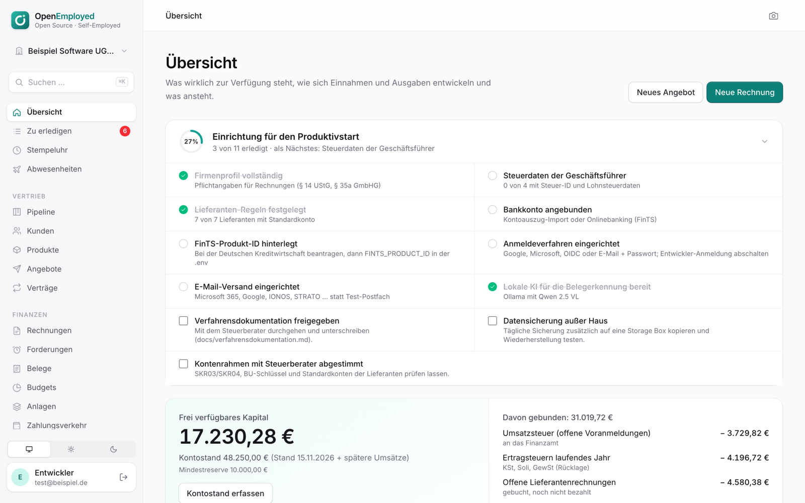

# OpenEmployed

**Open Source + Self-Employed:** Rechnungen, Buchhaltung, Lohn, Steuern und Projekte für Selbstständige, UG und GmbH –
selbst gehostet, GoBD-konform, ohne Abo. Gedacht als Ersatz für lexoffice, sevDesk & Co. inklusive Lohnbuchhaltung.

Betrieb: [docs/betrieb.md](docs/betrieb.md) ·
Lokal ausprobieren: [docs/lokal-testen.md](docs/lokal-testen.md) · GoBD-Verfahrensdokumentation: [docs/verfahrensdokumentation.md](docs/verfahrensdokumentation.md)

<picture>
  <source media="(prefers-color-scheme: dark)" srcset="docs/bilder/dashboard-dark.png">
  
</picture>

## Was OpenEmployed kann

| Bereich | Funktionen |
|---|---|
| **Vertrieb** | Pipeline (Leads → Angebot → Vertrag), Angebote mit Online-Annahme, Verträge mit Abo-Abrechnung, Kundenportal |
| **Rechnungen** | E-Rechnung ZUGFeRD/Factur-X und **XRechnung 3.0** (Leitweg-ID), Versand per E-Mail oder **Peppol**, Auslandskunden (EU-Reverse-Charge, Drittland), **Fremdwährungen** mit EZB-Kurs, Mahnwesen |
| **Belege** | Belegpostfach (IMAP), Handy-Erfassung, Lieferanten-Regeln, lokale KI-Erkennung (Ollama/Qwen) |
| **Buchhaltung** | Doppelte Buchführung SKR03/SKR04, Bankimport (CAMT/MT940/CSV, FinTS), Anlagen und AfA, Eröffnungsbilanz, DATEV-Import/-Export, Monatsabschluss, Jahresabschluss-Paket |
| **Zahlungsverkehr** | SEPA-Überweisungen (pain.001) und -Lastschriften mit Mandaten (pain.008) |
| **Lohn** | Lohnsteuer exakt nach amtlichem Programmablaufplan 2026 (gegen BMF-Rechner geprüft), Midijob/Übergangsbereich, Minijob, Sonderzahlungen, Sachbezüge und Dienstwagen, Pfändung (§ 850c ZPO), Entgeltabrechnung mit allen Pflichtangaben, DEÜV-Meldungen, Beitragsnachweise, Lohnsteuerbescheinigung, Lohnbuchung, **Mitarbeiter-Portal** |
| **Personal** | Stempeluhr, Urlaub und Abwesenheiten, Feiertage aller Bundesländer im Kalender, Überstunden und Zeitkonto, On-/Offboarding-Checklisten, digitale Personalakte mit Vertragsvorlagen |
| **Signaturen** | Verträge über **Documenso** (automatisch verbunden), Prüfung der Formvorschriften (Textform/Schriftform), optional qualifizierte elektronische Signatur über externen Anbieter, sonst Ausdruck oder E-Mail mit Scan-Rücklauf |
| **Steuern** | UStVA mit ELSTER-Versand (ERiC), ZM, Dauerfristverlängerung, KSt-/GewSt-Vorauszahlungen, BWA mit Vorjahresvergleich |
| **Archiv** | Revisionssicher: Hash-Kette, Aufbewahrungsfristen, Volltextsuche, gesendete E-Mails als .eml, Spiegelung auf S3 (Object Lock) / WebDAV / Festplatte, GoBD-Export mit Prüfskript |
| **Team** | Projekte (Kanban), Zeiterfassung mit Abrechnung, Reisekosten |
| **Automatisierung** | Eingebaute Jobs plus eigene **Workflows** (Cron/Ereignis, Blöcke mit Wenn/Sonst, E-Mail, Aufgabe, HTTP, Python in Sandbox), REST-API-Schlüssel, signierte Webhooks |
| **Verwaltung** | Mehrere Firmen, Rollen (Geschäftsführung, Buchhaltung, Steuerberater nur lesen, Mitarbeiter), Anmeldung per Google, Microsoft, OIDC oder E-Mail + Passwort + 2FA, Einstellungen in der App, Datensicherung |

## Schnellstart

Voraussetzungen: Docker mit Compose, `make`, `openssl`, `python3`.

```bash
make install-lokal   # zum Ausprobieren: Testpostfach, Entwickler-Anmeldung, Demodaten mit „make demo“
```

```bash
make install         # Server hinter nginx (Ports nur auf 127.0.0.1), danach /einrichtung im Browser
```

| Adresse (lokal) | Dienst |
|---|---|
| http://localhost | OpenEmployed |
| http://localhost:8025 | Testpostfach (Mailpit) – nichts verlässt den Rechner |
| http://localhost/api/docs | API-Dokumentation (nicht in Produktion) |
| http://sign.localhost | Documenso (digitale Signatur) |

Updates: `make update` (Sicherung → neuer Stand → Neubau → Migrationen). Sicherung sofort: `make backup`.

## Einrichtung

Nach dem ersten Start führt der Assistent unter **/einrichtung** durch Firma, Steuern, E-Mail, Anmeldung und Team. Alles lässt sich
später unter *System & Integrationen* ändern – ohne `.env`-Bearbeitung (Geheimnisse liegen verschlüsselt in der Datenbank).

- **E-Mail:** Microsoft 365 (OAuth), Google Workspace, IONOS, STRATO, netcup, Hetzner, mailbox.org, Posteo, GMX, WEB.DE, Telekom, iCloud,
  Fastmail, Zoho oder eigener Server – Details in [docs/betrieb.md](docs/betrieb.md#4a-e-mail-anbieter).
- **Anmeldung:** Google, Microsoft Entra ID, beliebiger OIDC-Anbieter (Keycloak, Authentik …) oder E-Mail + Passwort mit TOTP.
- **ELSTER, KI, Peppol:** siehe [docs/betrieb.md](docs/betrieb.md).

## Architektur

| Dienst | Technik |
|---|---|
| `frontend` | Next.js 16, Tailwind 4 |
| `backend` | FastAPI, SQLAlchemy (async), Alembic |
| `ledger` | Rust (axum) – Festschreibung mit Hash-Kette und lückenlosen Nummernkreisen (GoBD) |
| `postgres` | PostgreSQL 17 |
| `ollama` | lokale KI (Qwen 2.5 VL) für die Belegerkennung |
| `sandbox` | isolierte Ausführung von Python-Schritten in Workflows |
| `documenso` | digitale Signatur (selbst gehostet) |
| `backup` | tägliche, geprüfte Datensicherung |

Tests: `make test` · Typprüfung und Linter: `make lint`.


## Mitmachen

Fehler und Ideen gern als [Issue](../../issues) melden, Änderungen als Pull Request. Vor einem Pull Request bitte die Tests
ausführen (`make test`) und `make lint`. Sicherheitslücken bitte **nicht** öffentlich melden – siehe [SECURITY.md](SECURITY.md).

## Haftungsausschluss

OpenEmployed ersetzt keine Steuer- oder Rechtsberatung. Steuer-, Lohn- und Sozialversicherungswerte werden sorgfältig gepflegt
und gegen amtliche Prüfdaten getestet, dennoch ohne Gewähr. Abschlüsse und Meldungen bitte mit eurer Steuerberatung abstimmen;
vor dem Produktivstart einen Monat parallel mit dem bisherigen Lohnbüro abrechnen. Technische Kennungen (Datenbank,
Docker-Volumes) heißen aus Kompatibilitätsgründen noch `selbstlite`.

## Lizenz

[GNU Affero General Public License v3.0](LICENSE) – frei nutzbar, veränderbar und weitergebbar. Wer eine veränderte Fassung
als Dienst für andere betreibt, muss den Quellcode dieser Fassung ebenfalls offenlegen.
